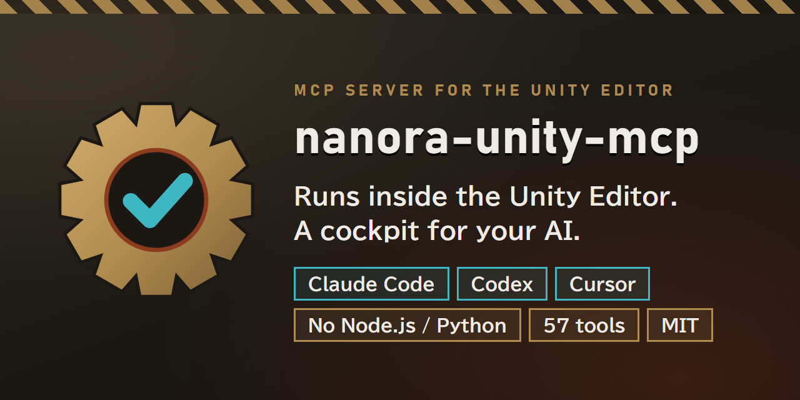
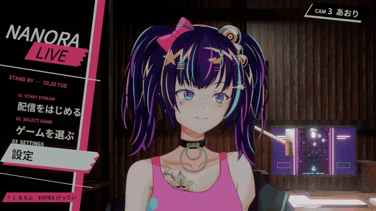
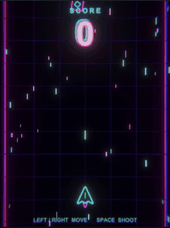
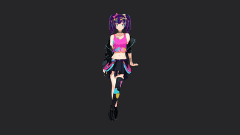
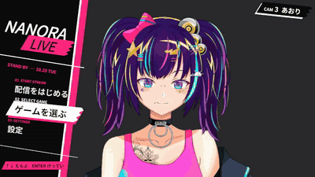

# nanora-unity-mcp



**An MCP server that lives inside the Unity Editor.** Let Claude Code, Codex, Cursor or any MCP-capable coding agent build, play, test and profile your Unity project — with nothing else to install.

[](https://unity.com/)
[](https://unity.com/releases/unity-6)
[](LICENSE)

[日本語](README.md) | **English** · **[Documentation](https://nanora-sama.github.io/nanora-unity-mcp/)** (install, connecting each agent, every tool)

## Why this one

- **Unity is all you need.** The server is C# running in the Editor process. No Node.js, no Python, no separate server binary, no account or subscription.
- **Works with any coding agent.** The server speaks both Streamable HTTP (`/mcp`) and SSE (`/sse`), so any MCP-capable coding agent can connect. Tested with Claude Code, Codex, Cursor and Claude Desktop.
- **Checks its own work.** Playwright-style selectors, `wait_for_selector`, `assert_ui_state` and `simulate_input` let the AI play the game and verify the result, and the bundled skills make "did it actually apply?" part of the workflow.
- **Many projects, no mix-ups.** Each project gets a fixed port from its path, the agent's connection settings (such as `.mcp.json`) are written for you, and `/health` names the project so a client can confirm it reached the right Editor.
- **Local only.** Binds to 127.0.0.1, rejects foreign browser origins, keeps every reply with the client that asked.

## Install

**Package Manager (Git URL)** — Window > Package Manager > **+** > *Add package from git URL…*

```
https://github.com/nanora-sama/nanora-unity-mcp.git?path=Assets/NanoraUnityMCP
```

**Tarball** — download `com.nanora.nanora-unity-mcp-<version>.tgz` from [Releases](https://github.com/nanora-sama/nanora-unity-mcp/releases) or BOOTH, then *Package Manager > **+** > Add package from tarball…* Dependencies are installed for you.

**.unitypackage** — install `com.unity.nuget.newtonsoft-json` first (*Add package by name…*), then *Assets > Import Package > Custom Package…* A .unitypackage cannot install dependencies or carry the sample.

Requires Unity 2021.3 LTS or later. The server starts with the Editor; the Setup Wizard (**Window > Unity MCP > Setup Wizard**) opens on first launch.

## Connect your coding agent

The port is chosen from the project path (51726–51825) and shown in **Window > Unity MCP Server**.

| Agent | How |
|---|---|
| Claude Code | Start `claude` in the project folder. `.mcp.json` is created automatically. |
| Codex | `codex mcp add nanora-unity-mcp --url http://127.0.0.1:<PORT>/mcp` |
| Claude Desktop | `"nanora-unity-mcp": { "url": "http://localhost:<PORT>/sse" }` in `claude_desktop_config.json` |
| Cursor | the same entry in `.cursor/mcp.json` |
| Any other MCP-capable agent | register `http://127.0.0.1:<PORT>/mcp` (Streamable HTTP) or `http://127.0.0.1:<PORT>/sse` (SSE) as an MCP server |

The Setup Wizard can configure detected agents for you. Enable **Background Execution** in the wizard (or call `configure_editor` with `optimize_for_mcp`) so Unity answers while it is not focused.

## See it build something

Six prompts, one per level, and nothing touched by hand after each prompt. The AI (Claude Code in this recording) drove Unity through this server, checked its own work with screenshots, input and tests, and fixed what it found. Level 6 puts the pieces together into a game-stream screen:



<table>
<tr>
<td align="center"><br><sub>Lv.1 a shooter from an empty scene</sub></td>
<td align="center"><br><sub>Lv.3 camera work</sub></td>
<td align="center"><br><sub>Lv.4 start menu</sub></td>
</tr>
</table>

| Lv | The prompt (abridged) | What the AI did to check it |
|---|---|---|
| 1 | Build a vertical shooter from scratch. Left/right to move, Space to shoot, +1 per hit, night-neon look. Then play it with `run_e2e_test`. | The first run fired no bullets. It pressed one key at a time, read the game's values and this server's own code, found that a held key was being released, re-pressed it every 200 ms, and passed on the third run. |
| 2 | Put the Live2D character in a new scene and make three exaggerated expressions: a beaming smile, turning pale, a wink with the tongue out. | Read each parameter's range and its physics links first. "Pale" came out grey, so it found the overlay that draws it and tinted it blue. |
| 3 | A 12-second loop: dolly round to the face, crane down to a low angle, pull back to full body. Render at 30 fps and check the frames. | Rendered all 360 frames and read the camera values. The close-up cut off the hair ornament; the third render was clean. |
| 4 | A stylised start screen: a title and three menu items, Up/Down and Enter, a camera switch per item. | Pressed the keys and looked: a clipped letter in the title, the wrong weekday, a line across the notice. Fixed all three. |
| 5 | A dim warehouse streaming room with flickering LEDs, built in Blender and brought into Unity. | Compared renders with a reference picture until they matched. (The Blender part uses other tools.) |
| 6 | Bring everything together into a game-stream screen: the room, the character, the cameras, the start screen; "Start stream" shows the game large with the character in a wipe. | The first screen let the game scene take the main camera, and the wipe hid the controls. It fixed the camera and moved the game 160 px left. |

The character (nanora) and the demo projects are not included; the package ships the server, the skills and the sample below.

### Try it yourself

Import **Samples > Shooting Game Sample** from the package page, then ask your AI:

```
Build the shooting game sample scene, play it, tap Space five times,
check that ScoreText is greater than 0, and show me a screenshot.
```

It will call `execute_menu_item`, `manage_playmode`, `simulate_input`, `assert_ui_state` and `capture_screenshot`. More prompts are in the [sample README](Assets/NanoraUnityMCP/Samples~/ShootingGame/README.md).

## Tools

57 tools in 18 categories (plus `list_categories` / `list_tools` / `execute` for SuperSave mode, below).

| Area | Tools |
|---|---|
| Scene | `get_scene_hierarchy`, `get_object_details`, `create_game_object`, `modify_game_object`, `delete_game_object`, `manage_scene` |
| Query | `query_objects` (U-Selector), `search_assets`, `wait_for_selector` |
| Batch | `batch_modify`, `batch_execute`, `destroy_objects`, `set_active`, `instantiate_asset` |
| Code | `execute_csharp` (Roslyn), `execute_menu_item`, `compile_project`, `get_compilation_errors`, `unity_reflect` |
| Play & test | `manage_playmode`, `simulate_input`, `assert_ui_state`, `run_tests`, `get_test_results`, `run_e2e_test`, `visual_regression_test`, `performance_budget_test`, `generate_test_report` |
| Performance | `analyze_frame`, `analyze_memory`, `profile_cpu`, `get_profiler_stats` |
| Diagnostics | `capture_screenshot`, `get_console_logs`, `mcp_status`, `diagnose_materials`, `repair_materials`, `configure_editor`, `setup_status`, `reconfigure_client`, `install_skills` |
| Assets & packages | `manage_assets`, `manage_prefabs`, `manage_packages`, `install_package`, `uninstall_package` |
| Scene building | lights, cameras, Cinemachine, UI canvases and elements, animation, audio |

Full reference: [Documentation~/ToolReference.md](Assets/NanoraUnityMCP/Documentation~/ToolReference.md).

**SuperSave mode**: set `NANORA_MCP_SUPERSAVE=1` to expose only the three meta tools. The AI lists categories, then the tools of one category, then calls through `execute`, which keeps the tool list out of its context.

### U-Selector

```
#Player                 by name
.Camera                 by component type
/Canvas/Menu/PlayButton by hierarchy path
.Enemy[tag=Boss]        with an attribute filter
ui:#StartButton         UI Toolkit element by name
```

## Bundled skills

For Claude Code for now: installed into `<Project>/.claude/skills/` when Claude Code is configured; your edits are kept on update (`install_skills` with `force: true` overwrites).

| Skill | Does |
|---|---|
| `/unity-verify-applied` | Confirms saved files, running state and the visible result before a change is called done |
| `/unity-pre-pr-check` | Revision, tests, saved state and visible behavior before a PR |
| `/unity-e2e-test` | Play Mode smoke test: wait, input, assert, screenshot |
| `/unity-material-repair` | Finds and fixes pink materials with before/after screenshots |
| `/unity-performance-budget` | FPS, draw calls and memory against a budget |
| `/unity-scene-setup` | A new scene with lighting, camera and ground |

## Endpoints

| Path | Use |
|---|---|
| `POST /mcp` | Streamable HTTP (stateless, JSON replies). Notifications get `202`. |
| `GET /sse` + `POST /message?sessionId=…` | Legacy SSE; each connection gets its own session. |
| `POST /message` | Direct JSON-RPC request/reply for scripts. |
| `GET /health` | Project name and path, process id, version, protocol version, transports. Answers during compiles. |
| `unity://project/info`, `unity://editor/state` | Read-only resources: identity, compile failure, play/pause, loaded and unsaved scenes. |

Protocol versions 2024-11-05 through 2025-11-25 are negotiated.

### Domain reloads

Compiling and entering Play Mode reload scripts and restart the server for a few seconds. A request cut off by the reload gets a JSON-RPC error saying so. The tool may already have done its work: wait until `/health` answers, read the state (`mcp_status`, `unity://editor/state`, `manage_playmode` status), and only then decide whether to repeat a change. Never replay a mutation blindly. Turning off *Reload Domain* in **Project Settings > Editor > Enter Play Mode Settings** avoids the reload on Play.

## Verify an installation

With Node.js 20+ (only for these checks):

```
node scripts/mcp/verify-transport.mjs   # handshake, notifications, errors, Origin, SSE isolation, a tool call
node scripts/mcp/verify-codex.mjs       # an installed Codex client lists and calls the tools
```

## Security

`execute_csharp` and `execute_menu_item` run code in your Editor with your permissions. The server listens on loopback only; keep it that way, and review what your AI client is allowed to call. `execute_csharp` blocks some APIs (process launch, web clients) and stops runaway loops, but it is not a sandbox.

## Help

- Quick start and troubleshooting: [English](Assets/NanoraUnityMCP/Documentation~/QuickStart.md) / [日本語](Assets/NanoraUnityMCP/Documentation~/QuickStart_JP.md)
- Questions, bugs, ideas: [SUPPORT.md](SUPPORT.md) → [Issues](https://github.com/nanora-sama/nanora-unity-mcp/issues/new/choose)
- Security: [SECURITY.md](SECURITY.md) · Contributing: [CONTRIBUTING.md](CONTRIBUTING.md)

## License

[MIT](LICENSE). Bundled Roslyn and System.* assemblies: [THIRD-PARTY-NOTICES.md](THIRD-PARTY-NOTICES.md).

Issues and pull requests: [GitHub](https://github.com/nanora-sama/nanora-unity-mcp/issues).
