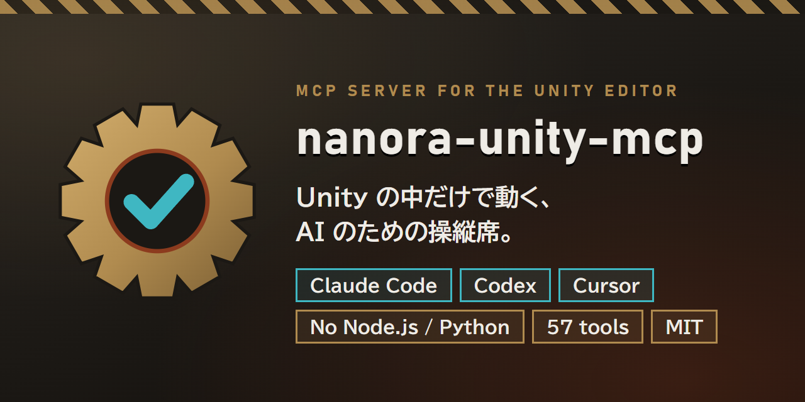
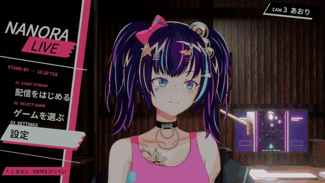
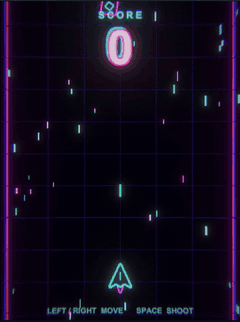
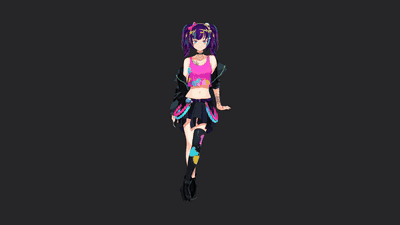
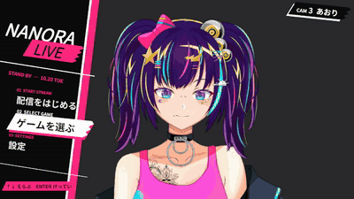

# nanora-unity-mcp



**Unity Editor の中で動く MCP サーバー。** Claude Code・Codex・Cursor などの MCP クライアントから、Unity プロジェクトを作る・遊ぶ・テストする・計測する。ほかに入れるものはありません。

[](https://unity.com/)
[](https://unity.com/releases/unity-6)
[](LICENSE)

**日本語** | [English](README.en.md)

## 特長

- **Unity だけで動く。** サーバーは Editor のプロセスで動く C# です。Node.js も Python も、別のサーバーも、アカウントや契約も要りません。
- **Codex と Claude が同じサーバーに。** Codex などの HTTP クライアントは `/mcp`（Streamable HTTP）、Claude Code・Claude Desktop・Cursor は `/sse`（SSE）。
- **自分の作業を確かめる。** Playwright 風のセレクタ、`wait_for_selector`・`assert_ui_state`・`simulate_input` で、AI がゲームを遊んで結果を確かめます。同梱の Skill で「本当に反映されたか」の確認を作業の手順に入れます。
- **Unity を何個開いても混線しない。** ポートはプロジェクトのパスから決まり、Claude Code 用の `.mcp.json` も自動で書きます。`/health` がプロジェクト名を返すので、正しい Editor につないだか確かめられます。
- **ローカルだけ。** 127.0.0.1 だけで待ち受け、外部のブラウザーからの要求は断り、応答は要求したクライアントにだけ返します。

## 導入

**Package Manager（Git URL）** — Window > Package Manager > **+** > *Add package from git URL…*

```
https://github.com/nanora-sama/nanora-unity-mcp.git?path=Assets/NanoraUnityMCP
```

**Tarball** — [Releases](https://github.com/nanora-sama/nanora-unity-mcp/releases) か BOOTH から `com.nanora.nanora-unity-mcp-<version>.tgz` をダウンロードし、*Package Manager > **+** > Add package from tarball…* で選びます。必要なパッケージも自動で入ります。

**.unitypackage** — 先に `com.unity.nuget.newtonsoft-json` を入れてから（*Add package by name…*）、*Assets > Import Package > Custom Package…*。.unitypackage は依存パッケージを入れられず、サンプルも含みません。

Unity 2021.3 LTS 以降。サーバーは Editor と一緒に起動し、初回は Setup Wizard（**Window > Unity MCP > Setup Wizard**）が開きます。

## クライアントをつなぐ

ポートはプロジェクトのパスから決まり（51726〜51825）、**Window > Unity MCP Server** に表示されます。

| クライアント | 方法 |
|---|---|
| Claude Code | プロジェクトのフォルダで `claude` を起動。`.mcp.json` は自動で作られます |
| Codex | `codex mcp add nanora-unity-mcp --url http://127.0.0.1:<PORT>/mcp` |
| Claude Desktop | `claude_desktop_config.json` に `"nanora-unity-mcp": { "url": "http://localhost:<PORT>/sse" }` |
| Cursor | 同じ内容を `.cursor/mcp.json` に |

見つかったクライアントは Setup Wizard が設定できます。Unity が前面にないときも応答するよう、ウィザードで **Background Execution** を有効にしてください（`configure_editor` の `optimize_for_mcp` でも可）。

## 作っているところを見る

Lv ごとに指示は 1 本だけ。指示のあとは人の手を入れていません。Claude Code がこのサーバーで Unity を操作し、スクリーンショット・入力・テストで自分の作業を確かめ、見つけたところを直しました。Lv.6 で全部を合わせて、ゲーム配信の画面にしています。



<table>
<tr>
<td align="center"><br><sub>Lv.1 空のシーンからシューティング</sub></td>
<td align="center"><br><sub>Lv.3 カメラワーク</sub></td>
<td align="center"><br><sub>Lv.4 始まりの画面</sub></td>
</tr>
</table>

| Lv | 指示（要約） | AI が確かめたこと |
|---|---|---|
| 1 | 縦スクロールのシューティングを最初から作って。左右で移動、スペースで撃つ、当てたらスコア +1、夜のネオン風。できたら `run_e2e_test` で遊んで確かめて。 | 1 回目は弾が出なかった。1 キーずつ押してゲームの値とこのサーバー自身のコードを読み、押しっぱなしのキーが外れていたのを見つけて 200 ms ごとに押し直し、3 回目で合格。 |
| 2 | 新しいシーンに Live2D のキャラクターを置いて、表情を 3 つ大げさに（満面の笑み・青ざめ・舌出しウインク）。 | 先に各パラメータの範囲と物理演算の連動を調べた。青ざめが灰色に見えたので、それを描く重ね絵を探して青く染めた。 |
| 3 | 回り込んで顔へ寄るドリー、あおりへのクレーン、引いて全身へ戻る 12 秒のループ。30fps で書き出して、コマを見て直して。 | 1 周 360 コマを書き出し、カメラの数値を読んだ。顔のアップで頭の飾りが切れていたのを直し、3 回目で解消。 |
| 4 | スタイリッシュな配信の始まりの画面。タイトルとメニュー 3 つ、上下と Enter、選ぶたびにカメラが切り替わる。 | キーを押して見た。タイトルの文字の切れ・曜日の誤り・お知らせを横切る線の 3 つを直した。 |
| 5 | LED がちかちかする薄暗い倉庫の配信室を Blender で作り、Unity へ持ち込む。 | 見本の絵と見比べて、近づくまで直した（Blender の部分は別の道具を使っています）。 |
| 6 | これまでの部品を全部集めて、ゲーム配信の画面に。倉庫の部屋・キャラクター・カメラ・始まりの画面。「配信をはじめる」でゲーム大＋キャラクターのワイプ。 | 1 回目はゲーム側のシーンがメインのカメラを取り、ワイプが操作説明を隠していた。カメラを直し、ゲームを 160px 左へ寄せた。 |

キャラクター（なのら）とデモのプロジェクトは同梱していません。パッケージに入っているのはサーバー・Skill・下のサンプルです。

### 自分で試す

パッケージのページから **Samples > Shooting Game Sample** を取り込み、AI にこう頼みます。

```
シューティングゲームのサンプルのシーンを作って Play し、スペースを 5 回押して、
ScoreText が 0 より大きいか確かめてからスクリーンショットを見せて。
```

`execute_menu_item`・`manage_playmode`・`simulate_input`・`assert_ui_state`・`capture_screenshot` を呼びます。ほかの頼み方は[サンプルの README](Assets/NanoraUnityMCP/Samples~/ShootingGame/README.md)にあります。

## ツール

18 分類・57 ツール（ほかに SuperSave モード用の `list_categories` / `list_tools` / `execute`。下で説明）。

| 分類 | ツール |
|---|---|
| シーン | `get_scene_hierarchy`, `get_object_details`, `create_game_object`, `modify_game_object`, `delete_game_object`, `manage_scene` |
| 検索 | `query_objects`（U-Selector）, `search_assets`, `wait_for_selector` |
| 一括 | `batch_modify`, `batch_execute`, `destroy_objects`, `set_active`, `instantiate_asset` |
| コード | `execute_csharp`（Roslyn）, `execute_menu_item`, `compile_project`, `get_compilation_errors`, `unity_reflect` |
| Play とテスト | `manage_playmode`, `simulate_input`, `assert_ui_state`, `run_tests`, `get_test_results`, `run_e2e_test`, `visual_regression_test`, `performance_budget_test`, `generate_test_report` |
| 性能 | `analyze_frame`, `analyze_memory`, `profile_cpu`, `get_profiler_stats` |
| 診断 | `capture_screenshot`, `get_console_logs`, `mcp_status`, `diagnose_materials`, `repair_materials`, `configure_editor`, `setup_status`, `reconfigure_client`, `install_skills` |
| アセットとパッケージ | `manage_assets`, `manage_prefabs`, `manage_packages`, `install_package`, `uninstall_package` |
| シーンづくり | ライト・カメラ・Cinemachine・UI のキャンバスと要素・アニメーション・音 |

詳しくは [Documentation~/ToolReference.md](Assets/NanoraUnityMCP/Documentation~/ToolReference.md)（英語）。

**SuperSave モード**: `NANORA_MCP_SUPERSAVE=1` で起動すると、3 つのメタツールだけを見せます。AI は分類の一覧 → 1 分類のツール → `execute` で呼ぶ、の順にたどるので、ツールの一覧が AI の文脈を埋めません。

### U-Selector

```
#Player                 名前で
.Camera                 コンポーネントの型で
/Canvas/Menu/PlayButton 階層のパスで
.Enemy[tag=Boss]        属性で絞り込み
ui:#StartButton         UI Toolkit の要素を名前で
```

## Claude Code の Skill

Claude Code を設定すると `<Project>/.claude/skills/` に入ります。更新しても自分で直した内容は残ります（`install_skills` の `force: true` で上書き）。

| Skill | すること |
|---|---|
| `/unity-verify-applied` | 「できた」と言う前に、保存されたファイル・動いている状態・見た目の結果を確かめる |
| `/unity-pre-pr-check` | PR の前に、リビジョン・テスト・保存状態・見た目の動きを確かめる |
| `/unity-e2e-test` | Play モードのスモークテスト（待つ・入力・判定・スクリーンショット） |
| `/unity-material-repair` | ピンクのマテリアルを見つけて直し、前後のスクリーンショットを撮る |
| `/unity-performance-budget` | FPS・描画数・メモリを予算と比べる |
| `/unity-scene-setup` | ライト・カメラ・地面のある新しいシーンを作る |

## エンドポイント

| パス | 用途 |
|---|---|
| `POST /mcp` | Streamable HTTP（状態なし・JSON で応答）。通知には `202` |
| `GET /sse` + `POST /message?sessionId=…` | 従来の SSE。接続ごとに別のセッション |
| `POST /message` | スクリプト用の JSON-RPC の直接の要求・応答 |
| `GET /health` | プロジェクト名とパス・プロセス ID・版・プロトコルの版・トランスポート。コンパイル中も応答 |
| `unity://project/info`, `unity://editor/state` | 読み取り専用のリソース：どのプロジェクトか・コンパイルの失敗・Play/一時停止・読み込み中と未保存のシーン |

プロトコルは 2024-11-05〜2025-11-25 の版で合わせます。

### ドメインリロード

コンパイルや Play モードへの切り替えでスクリプトが読み直され、サーバーは数秒止まります。リロードで打ち切られた要求には、その旨の JSON-RPC エラーを返します。ツールの処理はもう終わっているかもしれません。`/health` が応答するまで待ち、状態を読んでから（`mcp_status`・`unity://editor/state`・`manage_playmode` の status）、変更をやり直すか決めてください。変更の操作をそのまま繰り返さないこと。**Project Settings > Editor > Enter Play Mode Settings** で *Reload Domain* を切ると、Play のときのリロードがなくなります。

## 導入の確認

Node.js 20 以降で（この確認のときだけ必要です）:

```
node scripts/mcp/verify-transport.mjs   # ハンドシェイク・通知・エラー・Origin・SSE の分離・ツール呼び出し
node scripts/mcp/verify-codex.mjs       # 入っている Codex クライアントがツールを一覧して呼べるか
```

## セキュリティ

`execute_csharp` と `execute_menu_item` は、あなたの権限で Editor の中のコードを実行します。サーバーはループバック（127.0.0.1）だけで待ち受けます。その設定は変えず、AI クライアントに何を呼ばせるかを確かめてください。`execute_csharp` は一部の API（プロセスの起動・Web クライアント）を止め、終わらないループを打ち切りますが、サンドボックスではありません。

## 困ったとき

- クイックスタートと「困ったとき」: [日本語](Assets/NanoraUnityMCP/Documentation~/QuickStart_JP.md) / [English](Assets/NanoraUnityMCP/Documentation~/QuickStart.md)
- 質問・不具合・要望: [SUPPORT.md](SUPPORT.md) → [Issues](https://github.com/nanora-sama/nanora-unity-mcp/issues/new/choose)（日本語で大丈夫です）
- セキュリティ: [SECURITY.md](SECURITY.md) · 貢献: [CONTRIBUTING.md](CONTRIBUTING.md)

## ライセンス

[MIT](LICENSE)。同梱の Roslyn と System.* のアセンブリ: [THIRD-PARTY-NOTICES.md](THIRD-PARTY-NOTICES.md)。

Issue と Pull Request: [GitHub](https://github.com/nanora-sama/nanora-unity-mcp/issues)。
